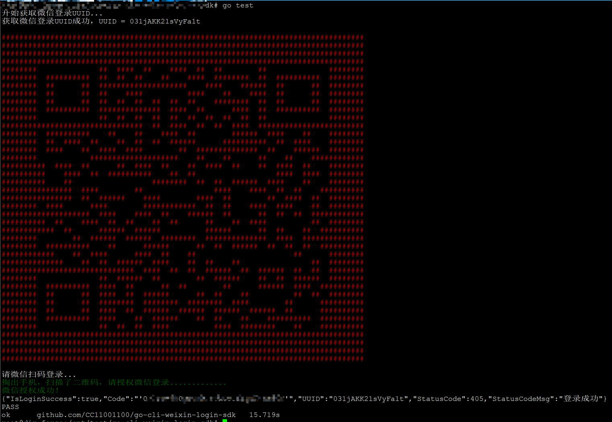

# Go CLI 微信登录 SDK

[](https://pkg.go.dev/github.com/golang-infrastructure/go-cli-weixin-login-sdk)
[](https://goreportcard.com/report/github.com/golang-infrastructure/go-cli-weixin-login-sdk)

## 项目介绍

这是一个用于命令行应用的微信扫码登录SDK，为基于命令行的Go应用提供微信扫码登录功能支持。该SDK可以在终端中直接显示二维码，用户通过微信扫描即可完成登录认证流程。



## 特性

- 在命令行终端中直接显示微信登录二维码
- 实时显示登录状态（等待扫码、已扫码、授权成功、授权失败等）
- 简单易用的API接口
- 无需复杂配置，只需提供微信AppID即可使用
- 支持登录状态的实时检查和反馈

## 安装

```bash
go get github.com/golang-infrastructure/go-cli-weixin-login-sdk
```

## 快速开始

### 基本使用

```go
package main

import (
	"fmt"
	wxlogin "github.com/golang-infrastructure/go-cli-weixin-login-sdk"
)

func main() {
	// 使用微信开放平台的AppID进行登录
	loginResult, err := wxlogin.Login("your_weixin_app_id")
	if err != nil {
		fmt.Println("登录失败:", err)
		return
	}

	// 检查登录是否成功
	if loginResult.IsLoginSuccess {
		fmt.Println("登录成功! 授权码:", loginResult.Code)
		// 使用授权码进行后续操作...
	} else {
		fmt.Println("登录失败，状态码:", loginResult.StatusCode)
		fmt.Println("失败原因:", loginResult.StatusCodeMsg)
	}
}
```

## API 文档

### Login 函数

```go
func Login(appId string) (*LoginResult, error)
```

参数:
- `appId`: 微信开放平台的应用ID

返回值:
- `*LoginResult`: 登录结果对象
- `error`: 如果发生错误，返回相应的错误信息

### LoginResult 结构体

```go
type LoginResult struct {
	// 是否登录成功
	IsLoginSuccess bool
	// 登录成功后的授权码
	Code string
	// 登录时使用的UUID
	UUID string
	// 状态码
	StatusCode int
	// 对状态码的解释
	StatusCodeMsg string
}
```

主要字段说明:
- `IsLoginSuccess`: 表示是否成功完成登录
- `Code`: 登录成功后获取的授权码，可用于后续获取用户信息或访问令牌
- `StatusCode`: 登录状态码，可能的值包括:
  - 402/500: 二维码过期
  - 403: 用户取消登录
  - 404: 用户扫描二维码成功
  - 405: 登录成功
  - 408: 等待登录

## 注意事项

1. 使用前需要在微信开放平台注册应用并获取AppID
2. 该SDK仅实现了微信扫码登录的基础流程，获取授权码后的后续操作（如获取用户信息、刷新token等）需自行实现
3. 命令行显示的二维码依赖于终端的字符显示能力，在某些终端可能显示效果不佳

## 许可证

[MIT License](LICENSE)


